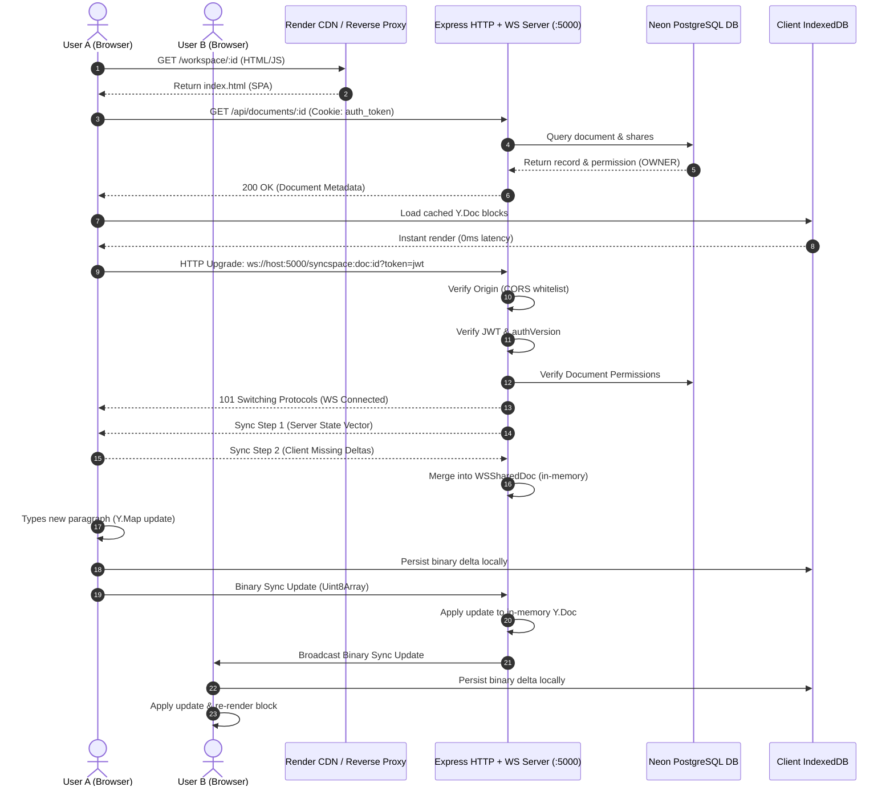

# 01. Project Overview & Architecture

## 1. Project Introduction

**SyncSpace** is an enterprise-ready, real-time collaborative workspace application that combines a block-based rich text document editor (similar to Notion) with an infinite collaborative whiteboard canvas (similar to Miro or Figma Jam).

SyncSpace allows multiple distributed users to simultaneously brainstorm, document, draw, connect ideas, and manage workspace assets with zero merge conflicts, sub-millisecond local UI responsiveness, offline capability, and fine-grained permission enforcement (`OWNER`, `EDITOR`, `VIEWER`).

```
┌────────────────────────────────────────────────────────────────────────┐
│                               SyncSpace                                │
│                                                                        │
│   ┌───────────────────────────┐    ┌───────────────────────────────┐   │
│   │    Rich Document Editor   │    │    Infinite Canvas Board      │   │
│   │  • Notion-style blocks    │    │  • Vector shapes & connectors │   │
│   │  • Slash commands (/)     │    │  • Freehand drawing & notes   │   │
│   │  • Real-time collaborative│    │  • Anchor point snapping      │   │
│   │    Yjs CRDT text typing   │    │  • Multi-user cursor tracking │   │
│   └───────────────────────────┘    └───────────────────────────────┘   │
│                 │                                  │                   │
│                 └─────────────────┬────────────────┘                   │
│                                   ▼                                    │
│                 ┌───────────────────────────────────┐                  │
│                 │      Core Platform Services       │                  │
│                 │  • Real-time Yjs WebSocket relay  │                  │
│                 │  • Role-based permissions         │                  │
│                 │  • JWT in HttpOnly cookies        │                  │
│                 │  • OAuth 2.0 PKCE (Google/GitHub) │                  │
│                 │  • Single-use password resets     │                  │
│                 │  • IndexedDB offline persistence  │                  │
│                 │  • Global workspace search (Cmd+K)│                  │
│                 └───────────────────────────────────┘                  │
└────────────────────────────────────────────────────────────────────────┘
```

---

## 2. Problem Statement

Collaborative productivity tools typically face three major engineering dilemmas:

1. **The Concurrency & Conflict Problem:**
   Traditional REST-based web apps save documents by sending the full document state or a diff back to a central SQL database. When two users edit simultaneously, the last write overwrites earlier changes ("Lost Update Problem"), or complex locks must be acquired, degrading user experience.
2. **The Offline & Latency Problem:**
   Requiring round-trip network acknowledgment before rendering typed keystrokes or moving canvas shapes creates perceptible input lag, especially on mobile or unstable network connections.
3. **The Authorization & Security Dilemma in WebSockets:**
   While REST APIs use standard middleware to enforce authorization per endpoint, WebSockets are persistent TCP connections. If authorization is checked only once at handshake, revoked permissions or logged-out users retain access until the socket closes. Furthermore, read-only viewers might forge message packets over the wire to modify document state.

### How SyncSpace Solves These Problems:
- **Yjs Conflict-free Replicated Data Types (CRDTs):** SyncSpace uses Yjs CRDTs. All changes are mathematically guaranteed to converge across all clients without a centralized locking mechanism.
- **Offline-First Local Replication (`y-indexeddb`):** Mutations are applied instantly to local memory and backed by browser IndexedDB storage before traversing the network. Edits made offline automatically reconcile when connectivity is restored.
- **Protocol-Level Role Enforcement & Active Session Revocation:** WebSockets authenticate via JWTs (from HttpOnly cookies or query tokens) and check document permissions in PostgreSQL. On every message frame, `VIEWER` connections are intercepted and blocked from broadcasting state updates. Furthermore, an `authVersion` tracking mechanism actively terminates open sockets if a user logs out or changes their password.

---

## 3. Core Feature Inventory

### A. Document Workspace (Rich Text Editor)
- **Block-Based Architecture:** Modular blocks (Paragraphs, Headings H1/H2, Bulleted Lists, Numbered Lists, Checklists/To-Dos, Blockquotes, Code Blocks).
- **Slash Commands (`/`):** Trigger quick command menu to insert or convert block types inline.
- **Granular CRDT Updates:** Each block is mapped to a collaborative `Y.Map` within a `Y.Array`. Property updates (content, checked status) do not delete or re-index other blocks, preventing cursor jumping.
- **Formatting Toolbar & Inspector:** Font family selection, font size, page width adjustments (Standard, Wide, Full), and document outline navigation.
- **Cover Image & Icon Customization:** Unsplash integration, custom cover URL assignment, and emoji/icon pickers.

### B. Infinite Canvas Whiteboard
- **Vector Shapes & Drawing:** Rectangles, rounded rectangles, circles, diamonds, triangles, stars, cylinders, clouds, pills, and custom frames.
- **Dynamic Connectors:** Smart arrows and lines with auto-snapping anchor points (`top`, `bottom`, `left`, `right`) based on Euclidean distance geometry.
- **Freehand Pen & Highlighting:** Pressure-smooth drawing paths with custom brush sizes and color palettes.
- **Sticky Notes & Text Cards:** Quick thought capture with auto-wrapping text.
- **Multi-User Real-Time Awareness:** Broadcasts live cursor coordinates (`x`, `y`), user display names, and distinct user colors with a 40ms throttle to prevent UI thrashing.
- **History Management:** Full 30-step undo/redo stack (`Ctrl+Z`, `Ctrl+Y`).
- **Viewport Navigation:** Smooth panning, mouse-wheel zooming (10% to 300%), and interactive minimap.

### C. Workspace & Asset Management
- **Dashboard Hub:** Unified view of Owned Documents, Shared Documents, Favorites, and Trash.
- **Soft-Delete Lifecycle:** Move to trash, restore from trash, and permanent deletion with owner-only access controls.
- **Global Search (Cmd/Ctrl + K):** Modal search supporting real-time debounced queries across document titles, type filtering (`All`, `Docs`, `Canvases`), and direct keyboard navigation.

### D. Authentication, Security & Sharing
- **Credential Auth:** Email/password registration and login secured with `bcryptjs` (12 salt rounds, minimum 10).
- **Session Tokens:** Stateless JWTs stored in `httpOnly`, `sameSite: 'lax'`, `secure: true` cookies.
- **Session Revocation:** Integer `authVersion` counter in the PostgreSQL `User` model. Changing passwords increments `authVersion`, invalidating all active tokens across devices.
- **OAuth 2.0 / OIDC:** Google and GitHub authentication using PKCE (`S256`) and cryptographically signed HMAC-SHA256 state cookies.
- **Password Reset:** 256-bit single-use cryptographic tokens. Token hashes (SHA-256) are stored in the database; raw tokens are passed in the URL hash (`#token=...`) to avoid server log leakage.
- **Sharing & Permissions:** Document owners can invite collaborators by email as either `EDITOR` or `VIEWER`. Changes apply in real time to REST and WebSocket channels.

---

## 4. Technology Stack Breakdown

| Layer | Technology | Version | Justification & Architectural Role |
|---|---|---|---|
| **Frontend Framework** | React | `^18.3.1` | Concurrent rendering, declarative component hierarchy, hook-based lifecycle. |
| **Language** | TypeScript | `~5.7.2` | End-to-end type safety, shared domain interfaces between client and server. |
| **Build Tool & Bundler** | Vite | `^6.1.0` | Sub-second HMR, optimized Rollup production builds, SPA asset handling. |
| **Routing** | React Router | `^7.18.2` | Data routers (`createBrowserRouter`), nested layout routes, protected route guards. |
| **Styling** | Tailwind CSS | `^3.4.17` | Utility-first responsive CSS, design-token consistency, zero runtime CSS overhead. |
| **Icons** | Lucide React | `^1.16.0` | Lightweight SVG icons matching modern design systems. |
| **CRDT Engine** | Yjs | `^13.6.23` | High-performance shared data types, minimal memory footprint, binary delta encoding. |
| **Local Persistence** | `y-indexeddb` | `^9.0.12` | Offline document replication directly to browser IndexedDB storage. |
| **Network Transport** | `y-websocket` & `ws` | `^2.1.0` / `^8.18.0` | WebSocket client/server protocol exchanging binary CRDT updates and awareness packets. |
| **Backend Runtime** | Node.js | `>=22` | Modern ECMAScript modules, native `process.loadEnvFile`, fast I/O event loop. |
| **Web Server** | Express | `^5.2.1` | Latest Express v5 router, middleware pipeline, shared port with WebSocket server. |
| **ORM** | Prisma | `^6.19.3` | Type-safe database client, declarative schema modeling, migration management. |
| **Database** | PostgreSQL (Neon) | `16+` | Serverless relational database with connection pooling, ACID compliance, and SSL. |
| **Authentication** | `jsonwebtoken` | `^9.0.3` | Compact, self-contained signed tokens with 7-day expiration. |
| **Password Hashing** | `bcryptjs` | `^3.0.3` | Adaptive salt rounds resistant to brute-force GPU attacks. |
| **OAuth Client** | `openid-client` | `^6.8.8` | Standards-compliant OpenID Connect / OAuth 2.0 client with PKCE. |
| **Schema Validation** | Zod | `^4.6.1` | Runtime schema validation on both frontend forms and backend API payloads. |
| **Email Delivery** | Resend REST API | `fetch` | Transactional email delivery for password reset links. |
| **Testing** | Vitest & Supertest | `^5.0.0` | Blazing fast ESM unit, route, and mock integration testing. |

---

## 5. Overall System Architecture

The following diagram illustrates how the frontend, Express backend, WebSocket relay, and Neon PostgreSQL database interact:



---

## 6. Key Architectural Decisions & Trade-Offs

### 1. Why CRDT (Yjs) over Operational Transformation (OT like Google Docs)?
- **OT Requires a Central Authority:** Operational Transformation requires a central server to order every single edit, transform incoming operations against historical logs, and acknowledge changes sequentially. If the server drops or network lags, clients must pause or buffer complex transformations.
- **CRDTs Commute Naturally:** Yjs represents data as a linked list of operations with Lamport timestamps and unique client IDs. Merges are commutative, associative, and idempotent ($A \cdot B = B \cdot A$). Any peer can merge updates in any order and arrive at the exact same state without server locking.
- **Offline First:** Users can edit documents on an airplane. When they reconnect, Yjs calculates the diff via state vectors and merges effortlessly.

### 2. Single Unified Port for HTTP and WebSockets
- In many starter projects, developers run Express on port 5000 and a separate `y-websocket` binary on port 1234.
- **SyncSpace Unified Architecture:** In `server/index.ts`, `http.createServer(app)` listens on a single port. When an HTTP request comes in, Express routes it. When an HTTP `upgrade` request arrives, the server checks the route, authenticates the socket, and delegates to `wss.handleUpgrade`.
- **Advantage:** Eliminates CORS friction, requires only one exposed port and one TLS certificate on hosting providers like Render, and prevents port-exhaustion in containerized environments.

### 3. In-Memory Yjs Relay with Frontend IndexedDB vs. Server Database Sync
- **Current Architecture:** Document metadata (titles, ownership, permissions, timestamps, soft-delete flags) is stored relationally in PostgreSQL. Document and canvas content is replicated in-memory in `WSSharedDoc` instances on the Node server and persisted permanently in users' browser `IndexedDB`.
- **Trade-Off:** If the backend server restarts while no users are connected, the in-memory relay clears. However, as soon as any collaborator with an IndexedDB cache re-opens the document, their browser sends its state to the server, immediately repopulating the server's state for all other participants.
- **Production Evolution:** In a large enterprise deployment, the backend would mount `y-leveldb` or a Redis pub/sub provider (`y-redis`) to persist binary updates to object storage (S3/GCS) or a PostgreSQL `BYTEA` column.

