# 02. Folder Structure & Dependency Topology

This document provides a complete anatomical guide to the SyncSpace repository, explaining the responsibility of every directory and important file, how modules depend on one another, and how clean separation of concerns is maintained.

---

## 1. High-Level Directory Tree

```text
SyncSpace/
├── dist/                             # Compiled production bundle (HTML, JS, CSS, _redirects)
├── prisma/                           # Database schema, migrations, and seeds
│   ├── migrations/                   # Sequential SQL migration files
│   └── schema.prisma                 # Declarative PostgreSQL schema & models
├── public/                           # Static public assets
│   └── _redirects                    # Render CDN SPA routing rewrite rules (/* -> /index.html 200)
├── server/                           # Backend Node.js / Express application
│   ├── index.ts                      # Unified HTTP & WebSocket server entry point
│   ├── yjsServer.ts                  # Hardened Yjs WebSocket server & WSSharedDoc
│   ├── middleware/                   # Express middlewares (requireAuth)
│   ├── routes/                       # REST API route controllers (auth, documents)
│   ├── types/                        # Server-specific TypeScript declarations
│   └── lib/                          # Modular server-side domains
│       ├── auth/                     # Password hashing, JWT, tokens, OAuth, email
│       ├── config/                   # CORS, environment loader, SPA fallback
│       ├── db/                       # Prisma client instance
│       └── yjs/                      # WebSocket origin & RBAC authorization
├── src/                              # Frontend React application
│   ├── main.tsx                      # Vite React entry point & DOM root
│   ├── App.tsx                       # App router mount
│   ├── index.css                     # Tailwind CSS imports & global styles
│   ├── auth/                         # Authentication context alias & helpers
│   ├── components/                   # Reusable UI components
│   │   ├── auth/                     # ProtectedRoute, OAuth buttons
│   │   ├── canvas/                   # CanvasBoard, tools, panels, math geometry
│   │   ├── collaboration/            # SyncPanel, ConflictDemo
│   │   ├── document/                 # Block editor, CoverPicker, ShareModal
│   │   ├── layout/                   # Sidebar, TopBar, MainLayout
│   │   └── search/                   # SearchModal (Cmd+K global search)
│   ├── context/                      # React Context providers (Auth, Workspace, DocumentUI)
│   ├── data/                         # Mock data & initial states
│   ├── hooks/                        # Custom React hooks (useDocumentYjs, useWorkspace)
│   ├── lib/                          # Frontend core libraries & API clients
│   │   ├── api/                      # Fetch clients for /api/auth and /api/documents
│   │   ├── validation/               # Zod validation schemas shared with backend
│   │   └── yjs/                      # WebSocket URL & room name resolvers
│   ├── pages/                        # Route pages (Dashboard, Workspace, Login, etc.)
│   ├── router/                       # React Router v7 configuration (createBrowserRouter)
│   ├── types/                        # Frontend TypeScript type declarations
│   └── utils/                        # Pure utility functions (geometry, search, time)
├── .env.example                      # Catalog of required environment variables
├── docker-compose.yml                # Optional local PostgreSQL container
├── package.json                      # Dependencies, scripts, and package metadata
├── render.yaml                       # Infrastructure-as-code Blueprint for Render
├── tailwind.config.js                # Tailwind CSS custom themes and color tokens
├── tsconfig.json                     # TypeScript compiler configuration
└── vite.config.ts                    # Vite bundler plugins and dev-server configuration
```

---

## 2. Directory & File Responsibilities

### Root Configuration Files
- **`package.json`**: Defines scripts (`dev`, `build`, `test`, `server:dev`, `start`), core dependencies (`react`, `express`, `yjs`, `prisma`, `bcryptjs`, `jsonwebtoken`, `openid-client`, `zod`), and dev-dependencies (`vite`, `vitest`, `typescript`, `tailwindcss`).
- **`tsconfig.json`**: Configures strict TypeScript checking (`noImplicitAny`, `strictNullChecks`), JSX support (`react-jsx`), and module resolution (`bundler`).
- **`vite.config.ts`**: Configures the React Vite plugin, build output target (`dist`), and local dev-server proxy settings.
- **`render.yaml`**: Declarative blueprint defining service specifications on Render, including route rewrites (`/* -> /index.html 200`) for Single-Page Application deep linking.
- **`public/_redirects`**: Standard static-site redirect rule file for Render and Netlify CDN layers. When a user requests deep links like `/workspace/123`, the CDN serves `/index.html` with HTTP 200 so React Router can mount.

---

### Backend Anatomy (`server/`)

The backend is organized with strict modularity:

#### 1. Core Entry Points
- **[`server/index.ts`](file:///d:/SyncSpace/server/index.ts)**:
  - Loads environment variables before anything else (`import './lib/config/env'`).
  - Initializes the Express application.
  - Mounts critical middleware: `apexDomainRedirect` (canonical `sync-space.me` -> `www.sync-space.me`), `cors(corsOptions)`, `express.json()`, `cookieParser()`.
  - Serves static assets and the SPA HTML fallback (`express.static(distPath)`, `createSpaFallbackMiddleware`).
  - Creates the shared HTTP server (`http.createServer(app)`) and hooks into the `'upgrade'` event to handle WebSocket connections.
  - Starts listening on `PORT` (default 5000) and `HOST` (`0.0.0.0`).
- **[`server/yjsServer.ts`](file:///d:/SyncSpace/server/yjsServer.ts)**:
  - ESM-native implementation of the Yjs WebSocket server.
  - Defines the `WSSharedDoc` class extending `Y.Doc`.
  - Implements role-based frame filtering: intercepts incoming messages and enforces read-only access for `VIEWER` roles.
  - Manages heartbeat ping/pong intervals (30s) to detect dropped TCP sockets.

#### 2. Route Controllers (`server/routes/`)
- **[`server/routes/auth.ts`](file:///d:/SyncSpace/server/routes/auth.ts)**:
  - Handles `/register`, `/login`, `/logout`, `/me`, `/ws-token`.
  - Implements Google & GitHub OAuth initiation and callback endpoints with PKCE code verification.
  - Implements `/forgot-password` (constant-time response to prevent email enumeration) and `/reset-password` (atomic token consumption via `updateMany`).
- **[`server/routes/documents.ts`](file:///d:/SyncSpace/server/routes/documents.ts)**:
  - Handles CRUD for documents (`GET /api/documents`, `POST /api/documents`, `GET /:id`, `PUT /:id`, `DELETE /:id`).
  - Handles sharing sub-resources (`POST /:id/share`, `GET /:id/shares`, `PATCH /:id/share/:userId`, `DELETE /:id/share/:userId`).
  - Enforces owner vs editor vs viewer permissions for every REST mutation.

#### 3. Middleware (`server/middleware/`)
- **[`server/middleware/auth.ts`](file:///d:/SyncSpace/server/middleware/auth.ts)**:
  - `requireAuth`: Extracts JWT from the HttpOnly cookie `auth_token` or Authorization Bearer header.
  - Verifies the signature and compares the token's `authVersion` against the database record to enforce active session revocations.

#### 4. Shared Server Libraries (`server/lib/`)
- **`server/lib/auth/`**:
  - `jwt.ts`: Retrieves and validates `JWT_SECRET` (fails fast in production if missing or weak), signs tokens (7-day expiry), verifies tokens, and sets/clears HttpOnly cookies.
  - `password.ts`: Hashes and compares passwords using `bcryptjs` (12 salt rounds, minimum 10).
  - `tokens.ts`: Generates 256-bit secure reset tokens, computes deterministic SHA-256 hashes for database indexing, and performs timing-safe comparisons via `crypto.timingSafeEqual`.
  - `oauth.ts`: Interfaces with `openid-client` for Google OIDC discovery and GitHub OAuth endpoints, sanitizes return paths, and implements safe account provisioning.
  - `email.ts`: Wraps the Resend API to deliver responsive HTML password reset emails.
- **`server/lib/config/`**:
  - `cors.ts`: Dynamic origin allowlist validator; supports localhost and LAN IPs in development, strictly restricts to configured domains in production.
  - `env.ts`: Native `process.loadEnvFile()` loader for server-side `.env` files.
  - `spa.ts`: Implements 301 apex-to-www redirection and Express 5-compatible SPA HTML fallbacks.
- **`server/lib/db/`**:
  - `client.ts`: Exports a singleton instance of `PrismaClient` to prevent connection exhaustion during development reloads.
- **`server/lib/yjs/`**:
  - `auth.ts`: Authorizes WebSocket upgrade requests before the protocol switch. Validates Origin, JWT, database ownership, and `DocumentShare` permissions.
  - `sessionConnections.ts`: In-memory registry mapping `userId -> Set<WebSocket>`. Allows instant eviction (`revokeUserConnections`) on logout or password change.

---

### Database Schema (`prisma/`)

- **[`prisma/schema.prisma`](file:///d:/SyncSpace/prisma/schema.prisma)**:
  - Defines the PostgreSQL data model:
    - `User`: Core account record with `email`, `passwordHash`, `name`, `avatarUrl`, and `authVersion`.
    - `Document`: Workspace document metadata with `title`, `type` (`doc` | `canvas`), `isFavorite`, `isDeleted`, `deletedAt`, and `userId` foreign key.
    - `DocumentShare`: Join table between `Document` and `User` specifying `permission` (`VIEWER` | `EDITOR`).
    - `ProviderAccount`: Linked OAuth provider identities (Google, GitHub) mapped to `User`.
    - `PasswordResetToken`: Stores hashed reset tokens (`tokenHash`), expiration dates, and consumption timestamps (`usedAt`).
  - Defines sequential database migrations in `prisma/migrations/`.

---

### Frontend Anatomy (`src/`)

The frontend follows standard React best practices, separating global contexts, layout containers, custom hooks, and presentation components:

#### 1. Routing & Root
- **[`src/main.tsx`](file:///d:/SyncSpace/src/main.tsx)**: Mounts React onto `#root`.
- **[`src/App.tsx`](file:///d:/SyncSpace/src/App.tsx)**: Renders `<AppRouter />`.
- **[`src/router/index.tsx`](file:///d:/SyncSpace/src/router/index.tsx)**:
  - Defines browser routes via `createBrowserRouter`:
    - Public: `/login`, `/register`, `/forgot-password`, `/reset-password`.
    - Protected: `/dashboard`, `/workspace/:id`, `/settings` (wrapped in `<ProtectedRoute>` and `<MainLayout>`).
  - Wraps the entire hierarchy in `<AuthProvider>`, `<WorkspaceProvider>`, and `<DocumentUIProvider>`.

#### 2. Context Providers (`src/context/`)
- **[`src/context/AuthContext.tsx`](file:///d:/SyncSpace/src/context/AuthContext.tsx)**: Manages `user`, `isAuthenticated`, `isLoading`, and handles session rehydration via `GET /api/auth/me`.
- **[`src/context/WorkspaceContext.tsx`](file:///d:/SyncSpace/src/context/WorkspaceContext.tsx)**: Manages document metadata, active users across documents via Yjs directory awareness, and optimistic updates for titles, favorites, and trash.
- **[`src/context/DocumentUIContext.tsx`](file:///d:/SyncSpace/src/context/DocumentUIContext.tsx)**: Manages UI preferences for the document editor (font family, font size, page width, drawer toggles).

#### 3. Custom Synchronization Hooks (`src/hooks/`)
- **[`src/hooks/useDocumentYjs.ts`](file:///d:/SyncSpace/src/hooks/useDocumentYjs.ts)**: The single source of truth for rich text document collaboration. Binds Yjs `Y.Array<Y.Map>` to React state, initializes `IndexeddbPersistence`, connects `WebsocketProvider`, handles awareness presence, and exposes atomic block mutators (`addBlock`, `updateBlock`, `deleteBlock`, `toggleChecklist`).
- **[`src/hooks/useWorkspace.ts`](file:///d:/SyncSpace/src/hooks/useWorkspace.ts)**: Convenience wrapper hook for consuming `WorkspaceContext`.

#### 4. Pages & Layouts (`src/pages/`, `src/components/layout/`)
- **`src/pages/Dashboard.tsx`**: Document grid/list views, quick creation, recent documents, favorites, and trash management.
- **`src/pages/Workspace.tsx`**: Dynamic switcher that reads route param `:id` and renders `<Editor>` (for `type: 'doc'`) or `<CanvasBoard>` (for `type: 'canvas'`).
- **`src/pages/DocumentWorkspace.tsx`**: The rich text document page containing the header, formatting bar, block list, cover picker, and slash command menu.
- **`src/components/canvas/CanvasBoard.tsx`**: The infinite whiteboard canvas container driven by `useCanvasEngine.ts`.
- **`src/components/layout/Sidebar.tsx`**: Navigation sidebar with workspace stats, folder links, user avatar dropdown, and global search trigger.
- **`src/components/search/SearchModal.tsx`**: Floating search modal listening for `Cmd+K` / `Ctrl+K`.

#### 5. Shared Contracts (`src/lib/validation/`, `src/lib/yjs/`)
- **`src/lib/validation/auth.ts`**: Zod schemas (`registerSchema`, `loginSchema`, `forgotPasswordSchema`, `resetPasswordSchema`) imported by both React frontend forms and Express backend routers for guaranteed contract parity.
- **`src/lib/yjs/rooms.ts`**: Deterministic room name encoders and parsers (`getDocumentRoomName`, `getCanvasRoomName`, `parseRoomName`) ensuring both client and server agree on room naming patterns (`syncspace:doc:<id>`, `syncspace:canvas:<id>`).

---

## 3. Dependency Graph

The following Mermaid diagram illustrates how modules depend on each other across the client-server boundary:

```mermaid
graph TD
    subgraph Shared Contracts
        VAL[src/lib/validation/auth.ts]
        ROOMS[src/lib/yjs/rooms.ts]
        TYPES[src/types/auth.ts]
    end

    subgraph Backend Services
        SRV_IDX[server/index.ts] --> COR[server/lib/config/cors.ts]
        SRV_IDX --> SPA[server/lib/config/spa.ts]
        SRV_IDX --> AUTH_RT[server/routes/auth.ts]
        SRV_IDX --> DOC_RT[server/routes/documents.ts]
        SRV_IDX --> YJS_SRV[server/yjsServer.ts]

        AUTH_RT --> VAL
        AUTH_RT --> TYPES
        AUTH_RT --> JWT[server/lib/auth/jwt.ts]
        AUTH_RT --> PWD[server/lib/auth/password.ts]
        AUTH_RT --> TKN[server/lib/auth/tokens.ts]
        AUTH_RT --> OAUTH[server/lib/auth/oauth.ts]
        AUTH_RT --> EMAIL[server/lib/auth/email.ts]
        AUTH_RT --> DB[server/lib/db/client.ts]

        DOC_RT --> DB
        DOC_RT --> REQ_AUTH[server/middleware/auth.ts]
        REQ_AUTH --> JWT
        REQ_AUTH --> DB

        YJS_SRV --> YJS_AUTH[server/lib/yjs/auth.ts]
        YJS_AUTH --> ROOMS
        YJS_AUTH --> JWT
        YJS_AUTH --> DB
        YJS_AUTH --> COR
    end

    subgraph Frontend Client
        APP[src/App.tsx] --> ROUTER[src/router/index.tsx]
        ROUTER --> AUTH_CTX[src/context/AuthContext.tsx]
        ROUTER --> WORK_CTX[src/context/WorkspaceContext.tsx]
        ROUTER --> PAGES[src/pages/*]

        AUTH_CTX --> API_AUTH[src/lib/api/auth.ts]
        API_AUTH --> VAL
        API_AUTH --> TYPES

        WORK_CTX --> API_DOC[src/lib/api/documents.ts]
        WORK_CTX --> YJS_CFG[src/lib/yjs/config.ts]
        WORK_CTX --> ROOMS

        PAGES --> DOC_HOOK[src/hooks/useDocumentYjs.ts]
        PAGES --> CANVAS_ENG[src/components/canvas/useCanvasEngine.ts]

        DOC_HOOK --> YJS_CFG
        DOC_HOOK --> ROOMS
        CANVAS_ENG --> YJS_CFG
        CANVAS_ENG --> ROOMS
    end
```



---

## 4. Separation of Concerns & Boundary Rules

1. **Database Isolation:**
   - Only backend code (`server/`) imports `@prisma/client`.
   - The frontend never connects directly to PostgreSQL. All database interactions occur through authenticated REST endpoints (`/api/*`).
2. **Secret Isolation:**
   - Secrets (`JWT_SECRET`, `DATABASE_URL`, `RESEND_API_KEY`, `OAUTH_CLIENT_SECRET`) are strictly read in Node.js server processes.
   - Vite only exposes variables prefixed with `VITE_` to the client browser (e.g. `VITE_WS_URL`). Secret environment variables are completely omitted from client bundles.
3. **Deterministic Room Isolation:**
   - Frontend and backend share the exact same room parsing logic (`src/lib/yjs/rooms.ts`).
   - A document room name is always `syncspace:doc:<uuid>`. A canvas room name is always `syncspace:canvas:<uuid>`. This ensures a canvas connection can never collide with or overwrite a document connection.

