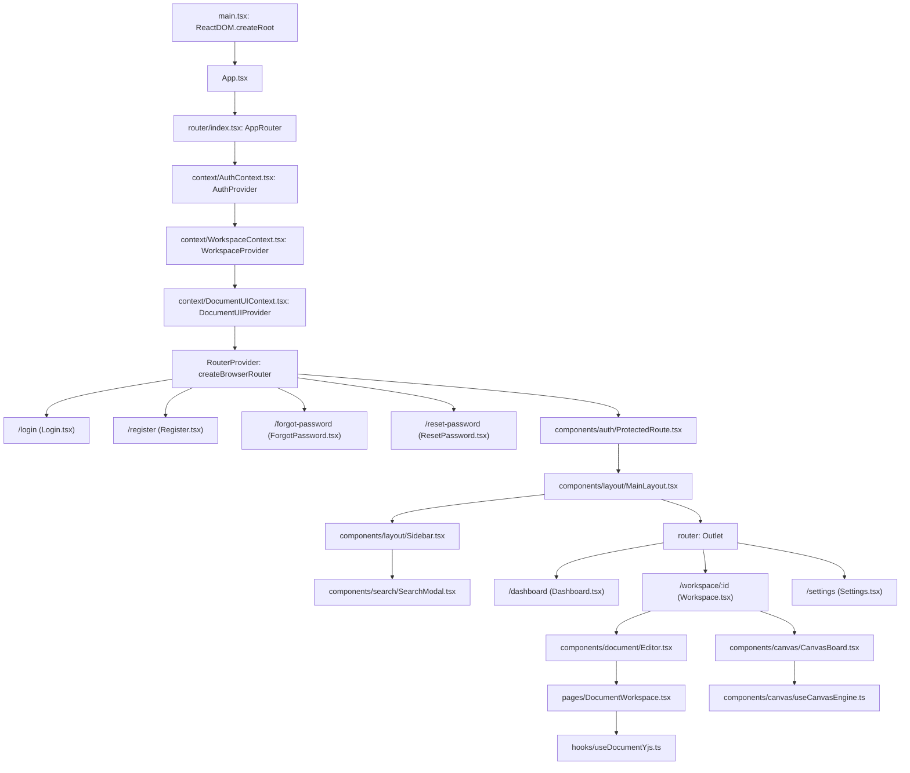
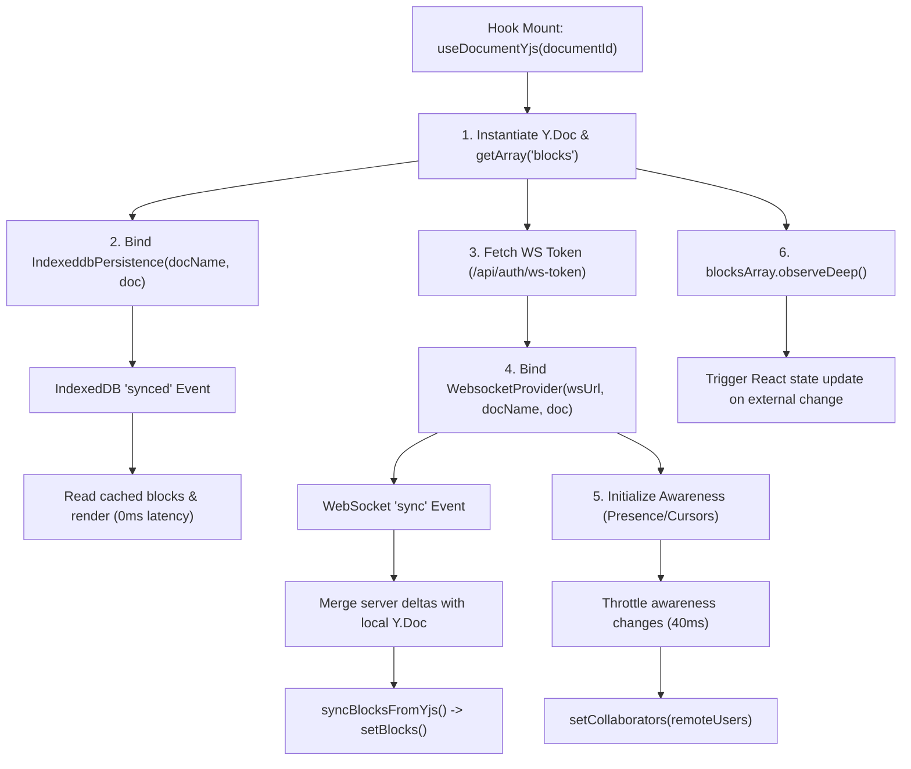

# 03. Frontend Deep Dive & State Architecture

This document covers the frontend architecture of SyncSpace, detailing React 18 patterns, state management strategies, custom synchronization hooks, routing, API integration, and TypeScript type safety.

---

## 1. React Architecture & Component Hierarchy

SyncSpace is structured around a nested layout and context hierarchy. Contexts provide coarse-grained shared domain models (session state, workspace directory, theme preferences), while high-frequency collaborative mutations (typing characters, moving canvas nodes) bypass global context entirely and live within custom CRDT hooks (`useDocumentYjs` and `useCanvasEngine`).



---

## 2. Route Architecture & Route Protection

SyncSpace uses **React Router v7** with the modern `createBrowserRouter` API.

### Layout Nesting & The Protected Route Pattern
In [`src/router/index.tsx`](file:///d:/SyncSpace/src/router/index.tsx), routes are declared as follows:

```tsx
const router = createBrowserRouter([
  { path: '/login', element: <Login /> },
  { path: '/register', element: <Register /> },
  { path: '/forgot-password', element: <ForgotPassword /> },
  { path: '/reset-password', element: <ResetPassword /> },
  {
    path: '/',
    element: <ProtectedRoute />,
    children: [
      {
        path: '/',
        element: <MainLayout />,
        children: [
          { index: true, element: <Navigate to="/dashboard" replace /> },
          { path: 'dashboard', element: <Dashboard /> },
          { path: 'workspace/:id', element: <Workspace /> },
          { path: 'settings', element: <Settings /> },
        ],
      },
    ],
  },
  { path: '*', element: <Navigate to="/dashboard" replace /> },
]);
```

### How `ProtectedRoute` Prevents Unauthorized Flashing
In [`src/components/auth/ProtectedRoute.tsx`](file:///d:/SyncSpace/src/components/auth/ProtectedRoute.tsx):

```tsx
export function ProtectedRoute() {
  const { isAuthenticated, isLoading } = useAuth();
  const location = useLocation();

  if (isLoading) {
    return (
      <div className="min-h-screen flex items-center justify-center bg-workspace-50">
        <div className="w-8 h-8 border-4 border-primary-600 border-t-transparent rounded-full animate-spin" />
      </div>
    );
  }

  if (!isAuthenticated) {
    return <Navigate to="/login" state={{ from: location }} replace />;
  }

  return <Outlet />;
}
```

**Interview Insight:** Why is `isLoading` critical here?
If `ProtectedRoute` only checked `!isAuthenticated`, refreshing any page would read the default initial state (`user = null`) before the background rehydration request (`GET /api/auth/me`) finishes, immediately redirecting valid users to `/login`. By holding render in a loading state until `isLoading === false`, session persistence across browser refreshes is completely seamless.

---

## 3. Global State Management (Contexts)

SyncSpace deliberately avoids heavy external state libraries (Redux, MobX, Zustand) for global app state, utilizing React's built-in Context API for three distinct functional domains:

### 1. `AuthContext` (`src/context/AuthContext.tsx`)
- **Responsibilities:** Session rehydration, tracking active user identity (`SafeUser`), login, registration, and logout operations.
- **Rehydration Lifecycle:** On component mount, an asynchronous effect calls `getCurrentUserApi()`. If the server responds with 200 (reading the HttpOnly session cookie), the user is populated; if 401 or network failure, user state settles as `null`.

### 2. `WorkspaceContext` (`src/context/WorkspaceContext.tsx`)
- **Responsibilities:**
  - Manages the active user's document index (`Record<string, DocumentMeta>`).
  - Fetches owned documents and shared documents simultaneously via `Promise.all([listDocumentsApi(), getSharedDocumentsApi()])`.
  - Connects to the root Yjs room `workspace-directory` to track active collaborator presence across documents.
  - Exposes optimistic UI mutation actions: `updateDocumentTitle`, `toggleFavorite`, `moveToTrash`, `restoreFromTrash`, `permanentlyDelete`.
- **Optimistic Updates:** When a user renames a document, `setDocuments` updates local state immediately, then fires `updateDocumentApi()`. If the API call fails, the catch block rolls back the state to the previous snapshot.

### 3. `DocumentUIContext` (`src/context/DocumentUIContext.tsx`)
- **Responsibilities:** Local UI preferences for the text editor that persist across documents (Font Family: Sans/Serif/Mono; Font Size: Small/Default/Large; Page Width: Standard/Wide/Full; Comments Drawer toggle; Inspector Drawer toggle).
- **Persistence:** Synchronized with browser `localStorage` under `syncspace_doc_theme`.

---

## 4. Deep Dive: `useDocumentYjs` (The CRDT Hook)

The [`src/hooks/useDocumentYjs.ts`](file:///d:/SyncSpace/src/hooks/useDocumentYjs.ts) hook is one of the most critical engineering components in SyncSpace. It bridges the gap between Yjs's distributed CRDT data structures and React's declarative state model.

### Complete Architecture of `useDocumentYjs`:



### Granular Property CRDT Mutations vs. Block Replacement
In early prototypes, updating a block's text deleted the block at index `i` and inserted a new block at index `i`.
**The Bug:** Deleting and re-inserting destroyed the block identity, reset remote user selection cursors, and caused severe text jumping during concurrent typing.

**The Solution in SyncSpace:**
Every block is stored inside the `Y.Array` as a nested `Y.Map<any>`. The `updateBlock` implementation performs granular property-level mutations:

```typescript
// Excerpt from src/hooks/useDocumentYjs.ts
const updateBlock = useCallback(
  (id: string, updates: Partial<DocumentBlock> | string, extra?: Partial<DocumentBlock>) => {
    const currentArray = blocksArrayRef.current;
    const currentDoc = ydocRef.current;
    if (!currentArray || !currentDoc) return;

    const patch: Partial<DocumentBlock> =
      typeof updates === 'string'
        ? { content: updates, ...extra }
        : { ...updates, ...extra };

    const idx = findBlockIndex(currentArray, id);
    if (idx === -1) return;

    const current = currentArray.get(idx);
    if (!current) return;

    // Granular Y.Map mutation (Preserves block identity across peers)
    if (current instanceof Y.Map) {
      currentDoc.transact(() => {
        if (patch.content !== undefined && current.get('content') !== patch.content) {
          current.set('content', patch.content);
        }
        if (patch.type !== undefined && current.get('type') !== patch.type) {
          current.set('type', patch.type);
        }
        if (patch.checked !== undefined && current.get('checked') !== patch.checked) {
          current.set('checked', patch.checked);
        }
      });
    }
  },
  []
);
```

### Why Wrap Updates in `currentDoc.transact()`?
- `doc.transact(fn)` bundles all mutations into a **single atomic transaction**.
- Emits exactly one update event to local observers and creates exactly one binary network packet over the WebSocket.
- Prevents intermediate rendering states where a block type has changed but its content has not yet updated.

---

## 5. Deep Dive: `useCanvasEngine` (The Infinite Canvas Engine)

The [`src/components/canvas/useCanvasEngine.ts`](file:///d:/SyncSpace/src/components/canvas/useCanvasEngine.ts) hook powers the vector whiteboard.

### Mathematical Coordinate Transformation (Screen $\leftrightarrow$ Canvas World)
When a user clicks on the browser screen at `(clientX, clientY)`, that coordinate must be translated into the canvas's infinite coordinate system taking into account viewport pan `(viewport.x, viewport.y)` and zoom scale `viewport.zoom`:

$$\text{worldX} = \frac{\text{clientX} - \text{rect.left} - \text{viewport.x}}{\text{viewport.zoom}}$$
$$\text{worldY} = \frac{\text{clientY} - \text{rect.top} - \text{viewport.y}}{\text{viewport.zoom}}$$

### Smart Anchor Snapping for Connectors
In [`src/utils/canvasGeometry.ts`](file:///d:/SyncSpace/src/utils/canvasGeometry.ts), connectors dynamically bind to shapes using Euclidean distance calculation:

```typescript
export function getClosestAnchorSide(shape: CanvasElement, point: Point): 'top' | 'bottom' | 'left' | 'right' {
  const anchors = [
    { side: 'top' as const, pt: { x: shape.x + shape.width / 2, y: shape.y } },
    { side: 'bottom' as const, pt: { x: shape.x + shape.width / 2, y: shape.y + shape.height } },
    { side: 'left' as const, pt: { x: shape.x, y: shape.y + shape.height / 2 } },
    { side: 'right' as const, pt: { x: shape.x + shape.width, y: shape.y + shape.height / 2 } },
  ];

  let minDistance = Infinity;
  let closestSide: 'top' | 'bottom' | 'left' | 'right' = 'top';

  for (const { side, pt } of anchors) {
    const dist = Math.hypot(pt.x - point.x, pt.y - point.y);
    if (dist < minDistance) {
      minDistance = dist;
      closestSide = side;
    }
  }

  return closestSide;
}
```
When a connected shape is dragged across the canvas, connected lines automatically update their anchor points, recalculate bounding boxes, and re-render in real time.

---

## 6. Global Search Architecture (`SearchModal.tsx`)

SyncSpace provides a modal search dialog accessible anywhere in the application via `Ctrl+K` or `Cmd+K`.

### Performance Optimizations in Search:
1. **Keystroke Debouncing (150ms):**
   Rapid typing does not trigger array filtering or re-renders on every keypress. The query is debounced via `setTimeout` before updating `debouncedQuery`.
2. **Memoized Multi-Attribute Filtering (`searchUtils.ts`):**
   Searches both document title and type, filters out soft-deleted items unless in the trash view, and handles type categorization (`all`, `doc`, `canvas`).
3. **Regex Search Highlighting:**
   Matched substring queries are wrapped in `<mark>` tags safely escaping special regex characters (`replace(/[.*+?^${}()|[\]\\]/g, '\\$&')`).
4. **Keyboard Accessibility:**
   Supports `ArrowDown`, `ArrowUp`, `Enter` to navigate and open results directly, and `Escape` to close.

---

## 7. API Integration Layer (`src/lib/api/`)

All HTTP communication is centralized in [`src/lib/api/auth.ts`](file:///d:/SyncSpace/src/lib/api/auth.ts) and [`src/lib/api/documents.ts`](file:///d:/SyncSpace/src/lib/api/documents.ts).

### Standardized `handleResponse` Helper
```typescript
async function handleResponse<T>(res: Response): Promise<T> {
  if (!res.ok) {
    let errorMessage = 'An unexpected error occurred';
    try {
      const data = await res.json();
      errorMessage = data.error || data.message || errorMessage;
    } catch {
      errorMessage = res.statusText || errorMessage;
    }
    throw new Error(errorMessage);
  }
  return res.json();
}
```

### Why `credentials: 'include'` on Every Request?
Because session authentication uses an `httpOnly` secure cookie (`auth_token`), browser `fetch` calls must explicitly specify `credentials: 'include'`. Without this setting, browsers omit cookies from cross-origin or same-site requests, resulting in intermittent 401 Unauthorized errors.

---

## 8. TypeScript Usage & Type Safety

SyncSpace enforces rigorous compile-time type safety. Key domain types include:

- **`SafeUser` (`src/types/auth.ts`)**: Represents user data safe for client-side consumption (strips sensitive fields like `passwordHash`).
- **`DocumentMeta` (`src/types/dashboard.ts`)**: Unifies backend relational data with client-side flags (`isFavorite`, `isDeleted`, `permission: 'OWNER' | 'EDITOR' | 'VIEWER'`).
- **`CanvasElement` (`src/types/canvas.ts`)**: Discriminated union and property interface representing vector shapes, text cards, sticky notes, connectors, and freehand drawing paths.
- **`DocumentBlock` (`src/types/documentTheme.ts`)**: Core model for rich-text blocks (`id`, `type`, `content`, `checked`).

