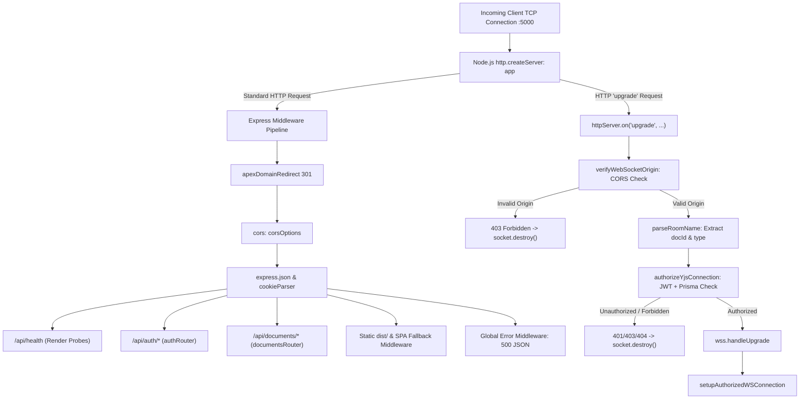
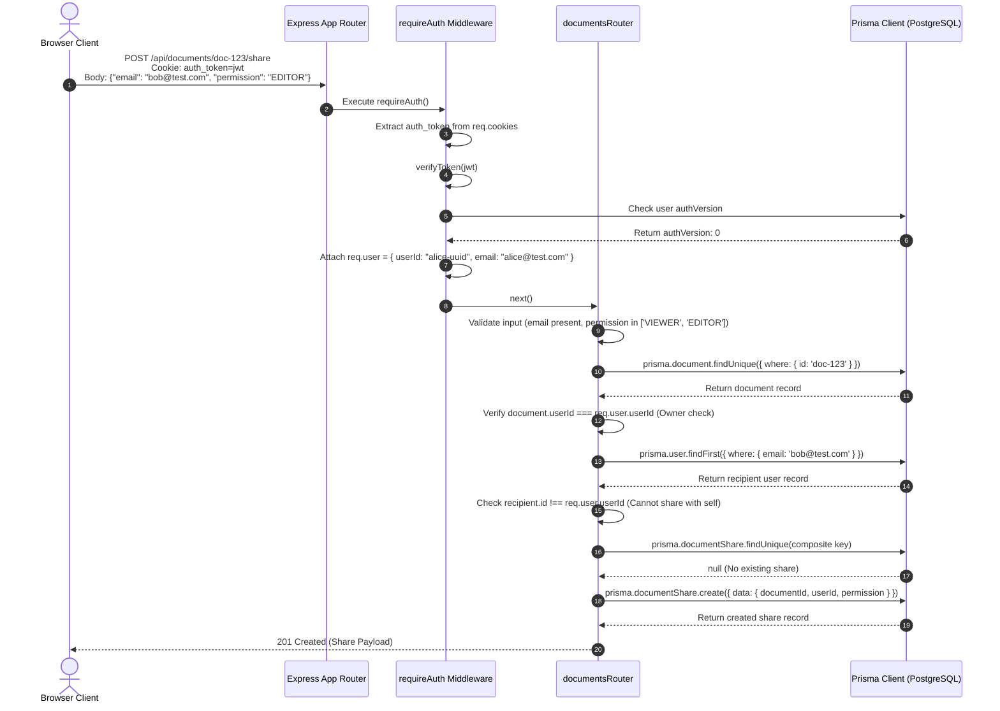

# 04. Backend Deep Dive & Server Architecture

This document explores the backend architecture of SyncSpace, detailing the Node.js/Express v5 server design, middleware pipeline, unified HTTP/WebSocket architecture, request-response lifecycles, and validation mechanisms.

---

## 1. Node.js & Express Architecture

The backend of SyncSpace is built on **Node.js (v22+)** and **Express (v5.2.1)** using native ECMAScript Modules (`"type": "module"` in `package.json`).

### Why Express 5?
Express 5 brings several modern advantages over Express 4:
- **Native Promise / Async Error Handling:** Async route handlers that throw or return rejected promises automatically pass the error to Express error middleware without requiring manual `try/catch` wrapping or `next(err)` boilerplates.
- **Improved Routing Engine:** Uses `path-to-regexp` v8 for more predictable route parameter matching.
- **Standardized Query Parsing:** Better security defaults against query string prototype pollution.

---

## 2. The Unified Single-Port Architecture

A common architectural challenge in real-time applications is whether to run the WebSocket server on a separate port (e.g. Express on 5000, WebSockets on 1234) or unify them.

### SyncSpace's Architectural Choice: Single Shared Port
SyncSpace mounts both Express REST endpoints and the Yjs WebSocket server on a single HTTP server listening on `PORT` (`5000`).



### How the Unified Upgrade Handler Works in Code
From [`server/index.ts`](file:///d:/SyncSpace/server/index.ts):

```typescript
const httpServer = http.createServer(app);
const { wss } = createYjsServer();

httpServer.on('upgrade', async (req, socket, head) => {
  try {
    // 1. Verify WebSocket Origin before completing upgrade (CSWSH defense)
    if (!verifyWebSocketOrigin(req)) {
      socket.write('HTTP/1.1 403 Forbidden\r\nContent-Type: text/plain\r\n\r\nOrigin not allowed');
      socket.destroy();
      return;
    }

    const url = new URL(req.url || '/', `http://${req.headers.host || 'localhost'}`);
    const rawRoomName = decodeURIComponent(url.pathname.slice(1).split('?')[0]);

    if (!rawRoomName) {
      socket.write('HTTP/1.1 400 Bad Request\r\n\r\nRoom name required');
      socket.destroy();
      return;
    }

    // 2. Authorize user against database (JWT + document permissions)
    const authResult = await authorizeYjsConnection(req, rawRoomName, url);

    if (!authResult.authorized) {
      const statusText = authResult.status === 401 ? 'Unauthorized' : authResult.status === 403 ? 'Forbidden' : 'Not Found';
      socket.write(`HTTP/1.1 ${authResult.status} ${statusText}\r\nContent-Type: text/plain\r\n\r\n${authResult.reason || statusText}`);
      socket.destroy();
      return;
    }

    // 3. Complete WebSocket upgrade and attach role permissions
    wss.handleUpgrade(req, socket, head, (ws) => {
      setupAuthorizedWSConnection(ws, req, authResult, rawRoomName);
    });
  } catch (err) {
    socket.write('HTTP/1.1 500 Internal Server Error\r\n\r\n');
    socket.destroy();
  }
});
```

---

## 3. Middleware Architecture & Execution Pipeline

Express executes middleware sequentially. SyncSpace's middleware pipeline is configured deliberately to guarantee security, domain canonicalization, and SPA deep linking.

### 1. `apexDomainRedirect` ([`server/lib/config/spa.ts`](file:///d:/SyncSpace/server/lib/config/spa.ts))
Ensures requests hitting apex domain `sync-space.me` are 301-redirected to the canonical `https://www.sync-space.me` domain, preserving browser URL hashes (`#token=...`) and path parameters.

### 2. `cors(corsOptions)` ([`server/lib/config/cors.ts`](file:///d:/SyncSpace/server/lib/config/cors.ts))
Enforces that only whitelisted origins can communicate with the API. 
- In production, accepts only explicitly configured `CLIENT_URL` / `FRONTEND_URL` origins and `sync-space.me` domains.
- In development, permits `localhost` and RFC 1918 private LAN IP addresses (`192.168.x.x`, `10.x.x.x`, `172.16-31.x.x`) to enable testing across mobile devices and multiple computers on the same Wi-Fi.
- Automatically handles requests without an `Origin` header (like server-to-server health checks from Render or curl).

### 3. Body & Cookie Parsers
- `express.json()`: Parses incoming JSON bodies (max default 100kb).
- `cookieParser()`: Reads signed and unsigned cookies, specifically the `auth_token` and `oauth_transaction` cookies.

### 4. `requireAuth` ([`server/middleware/auth.ts`](file:///d:/SyncSpace/server/middleware/auth.ts))
Guards protected routes (`/api/documents/*`, `/api/auth/me`, `/api/auth/ws-token`).
1. Extracts token from `req.cookies.auth_token` or `req.headers.authorization`.
2. Verifies signature against the validated `JWT_SECRET`.
3. Queries `prisma.user.findUnique({ where: { id: userId }, select: { authVersion: true } })`.
4. If `user.authVersion !== payload.authVersion`, rejects with `401 Unauthorized` (enforcing session revocation).
5. Attaches sanitized identity to `req.user = { userId, email, authVersion }`.

### 5. SPA Fallback Middleware (`createSpaFallbackMiddleware`)
When the production frontend bundle exists in `dist/`:
- `express.static(distPath)` serves static assets (`/assets/*.js`, `/assets/*.css`, `favicon.ico`).
- For any remaining `GET` requests that are **not** prefixed with `/api`, serves `dist/index.html`. This ensures that when a user refreshes `/workspace/:id` or clicks a password-reset link, Express returns the SPA HTML instead of returning a 404.

### 6. Global Error Middleware
```typescript
app.use((err: unknown, _req: Request, res: Response, _next: NextFunction) => {
  console.error('Unhandled server error:', err);
  res.status(500).json({ error: 'Internal server error' });
});
```
Ensures no unhandled exception leaks server stack traces, database credentials, or file system paths to the client.

---

## 4. REST Request-Response Lifecycle

Here is the exact lifecycle of an authenticated request (for example, `POST /api/documents/:id/share`):



---

## 5. Validation Architecture (Zod Shared Contracts)

Validation is enforced using **Zod** (`zod@4.6.1`). Schemas are declared in `src/lib/validation/auth.ts` and shared directly between React forms and Express route handlers.

### Example: Registration Schema Contract
```typescript
// Shared Zod schema in src/lib/validation/auth.ts
export const registerSchema = z.object({
  email: z.string().email('Invalid email address').max(255),
  password: z
    .string()
    .min(8, 'Password must be at least 8 characters')
    .max(128, 'Password must not exceed 128 characters')
    .regex(/[A-Z]/, 'Password must contain at least one uppercase letter')
    .regex(/[0-9]/, 'Password must contain at least one number')
    .regex(/[^A-Za-z0-9]/, 'Password must contain at least one special character'),
  name: z.string().min(1, 'Name is required').max(100),
  avatarUrl: z.string().url('Invalid URL').optional().or(z.literal('')),
});
```

### Backend Enforcement in `server/routes/auth.ts`:
```typescript
const parseResult = registerSchema.safeParse(req.body);
if (!parseResult.success) {
  res.status(400).json({
    error: 'Validation failed',
    details: parseResult.error.issues,
  });
  return;
}
const { email, password, name, avatarUrl } = parseResult.data;
```

**Interview Insight:** Why share schemas between client and server?
- **Single Source of Truth:** Password complexity requirements or max lengths change in only one file.
- **Fail Early:** The client provides instant visual feedback in React before the form is submitted.
- **Defensive Defense-in-Depth:** If an attacker bypasses the frontend and submits invalid JSON directly to `POST /api/auth/register`, the backend Zod validation catches and rejects the payload with 400 Bad Request before database interaction.

