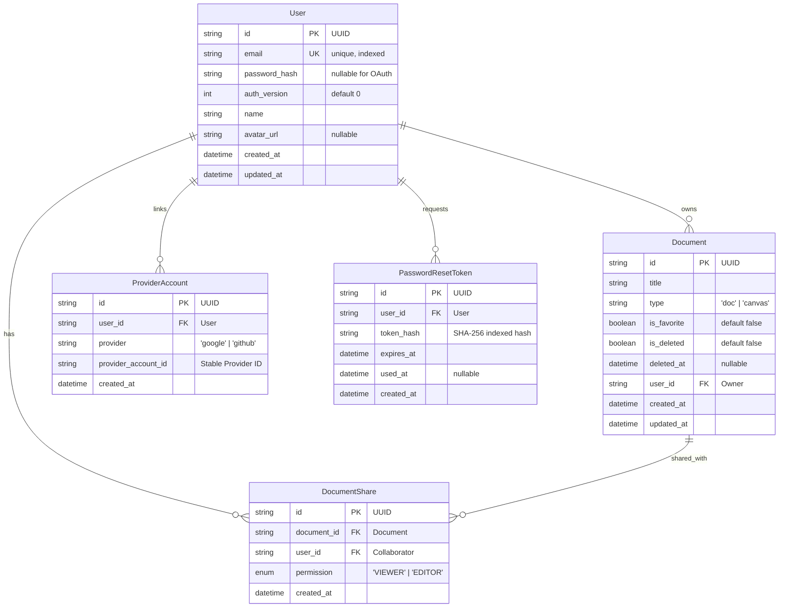

# 05. Database Architecture & Prisma ORM

This document provides a deep dive into SyncSpace's data persistence layer, detailing PostgreSQL on Neon, Prisma ORM modeling, relational schemas, indexing strategies, atomic transactions, and connection management.

---

## 1. PostgreSQL & Neon Serverless Architecture

SyncSpace uses **PostgreSQL (v16+)** hosted on **Neon**, a modern serverless PostgreSQL platform.

### Architectural Advantages of Neon for SyncSpace:
1. **Separation of Compute and Storage:** Neon decouples database compute (stateless Postgres nodes) from durable storage (Safekeeper and Page Server nodes). Compute automatically scales during high-traffic collaboration sessions and suspends when idle.
2. **Built-in Connection Pooling:** Node.js applications that spawn multiple workers or serverless invocations can easily exhaust PostgreSQL's `max_connections` limit. Neon provides a native PgBouncer connection pooler (`-pooler` connection string endpoint) that multiplexes hundreds of concurrent queries over a handful of persistent database backends.
3. **Mandatory Transport Security:** Neon enforces TLS encryption with `sslmode=require` and `channel_binding=require`, ensuring database credentials and sensitive user records are never exposed in cleartext over the wire.

---

## 2. Prisma ORM Architecture

SyncSpace employs **Prisma ORM (`^6.19.3`)** as its database access layer.

```
schema.prisma (Declarative Models)
       │
       ▼ (npx prisma migrate dev / npx prisma generate)
Generated TypeScript Client (@prisma/client)
       │
       ▼ (Type-safe SQL queries)
Neon PostgreSQL (Serverless Database)
```

### Singleton Client Instance (`server/lib/db/client.ts`)
To prevent connection leaks during local development (where hot-reloading tools like `tsx watch` frequently re-execute files):

```typescript
import { PrismaClient } from '@prisma/client';

declare global {
  var prisma: PrismaClient | undefined;
}

export const prisma =
  global.prisma ||
  new PrismaClient({
    log: process.env.NODE_ENV === 'development' ? ['warn', 'error'] : ['error'],
  });

if (process.env.NODE_ENV !== 'production') {
  global.prisma = prisma;
}
```
**Why this matters in an interview:** If a developer instantiates `new PrismaClient()` at the top of every route or file, every reload opens a new connection pool to PostgreSQL, quickly triggering `FATAL: remaining connection slots are reserved for non-replication superuser connections`. A global singleton guarantees that exactly one pool exists per Node process.

---

## 3. Relational Schema & Entity-Relationship Model

The database contains 5 core tables mapped from [`prisma/schema.prisma`](file:///d:/SyncSpace/prisma/schema.prisma):



---

## 4. Model Breakdown & Detailed Relationships

### 1. `User` Model
```prisma
model User {
  id                  String               @id @default(uuid())
  email               String               @unique
  passwordHash        String?              @map("password_hash")
  authVersion         Int                  @default(0) @map("auth_version")
  name                String
  avatarUrl           String?              @map("avatar_url")
  createdAt           DateTime             @default(now()) @map("created_at")
  updatedAt           DateTime             @updatedAt @map("updated_at")
  documentShares      DocumentShare[]
  documents           Document[]
  passwordResetTokens PasswordResetToken[]
  providerAccounts    ProviderAccount[]

  @@index([email])
  @@map("users")
}
```
- `passwordHash` is nullable: Users registered through Google or GitHub OAuth do not have a password hash.
- `authVersion`: Monotonically increasing counter for immediate multi-device session revocation.
- `@@map("users")`: Maps Prisma's PascalCase model to snake_case PostgreSQL tables, following standard SQL naming conventions.

### 2. `Document` Model
```prisma
model Document {
  id         String          @id @default(uuid())
  title      String
  type       String          // 'doc' or 'canvas'
  isFavorite Boolean         @default(false) @map("is_favorite")
  isDeleted  Boolean         @default(false) @map("is_deleted")
  deletedAt  DateTime?       @map("deleted_at")
  createdAt  DateTime        @default(now()) @map("created_at")
  updatedAt  DateTime        @updatedAt @map("updated_at")
  userId     String          @map("user_id")
  shares     DocumentShare[]
  user       User            @relation(fields: [userId], references: [id], onDelete: Cascade)

  @@index([userId])
  @@index([userId, isDeleted])
  @@map("documents")
}
```
- **Indexes:**
  - `@@index([userId])`: Accelerates listing documents owned by a user (`WHERE user_id = $1`).
  - `@@index([userId, isDeleted])`: Composite index optimized for the common dashboard query: `WHERE user_id = $1 AND is_deleted = false`.
- **Cascade Deletion (`onDelete: Cascade`):** If a `User` account is deleted, all documents owned by that user are automatically purged by PostgreSQL at the foreign key level.

### 3. `DocumentShare` Model
```prisma
model DocumentShare {
  id         String             @id @default(uuid())
  documentId String             @map("document_id")
  userId     String             @map("user_id")
  permission DocumentPermission
  createdAt  DateTime           @default(now()) @map("created_at")
  document   Document           @relation(fields: [documentId], references: [id], onDelete: Cascade)
  user       User               @relation(fields: [userId], references: [id], onDelete: Cascade)

  @@unique([documentId, userId])
  @@index([documentId])
  @@index([userId])
  @@map("document_shares")
}

enum DocumentPermission {
  VIEWER
  EDITOR
}
```
- **Composite Unique Constraint (`@@unique([documentId, userId])`):** Enforces at the database engine level that a document cannot be shared with the same user multiple times. Attempting a duplicate share raises a unique constraint violation (Prisma code `P2002`).
- **Cascade Rules:** If a document is deleted, all share records for that document cascade delete automatically. If a shared collaborator deletes their account, their share access is removed without altering the document.

### 4. `ProviderAccount` Model (OAuth Links)
```prisma
model ProviderAccount {
  id                String   @id @default(uuid())
  userId            String   @map("user_id")
  provider          String   // 'google' | 'github'
  providerAccountId String   @map("provider_account_id")
  createdAt         DateTime @default(now()) @map("created_at")
  user              User     @relation(fields: [userId], references: [id], onDelete: Cascade)

  @@unique([provider, providerAccountId])
  @@index([userId])
  @@map("provider_accounts")
}
```
- **Composite Unique Constraint (`@@unique([provider, providerAccountId])`):** Ensures a specific OAuth provider identity (e.g. GitHub user ID `12345678`) can be associated with at most one SyncSpace user account.

### 5. `PasswordResetToken` Model
```prisma
model PasswordResetToken {
  id        String    @id @default(uuid())
  userId    String
  tokenHash String    @map("token_hash")
  expiresAt DateTime  @map("expires_at")
  usedAt    DateTime? @map("used_at")
  createdAt DateTime  @default(now()) @map("created_at")
  user      User      @relation(fields: [userId], references: [id], onDelete: Cascade)

  @@index([userId])
  @@index([tokenHash])
  @@map("password_reset_tokens")
}
```
- `tokenHash` stores a deterministic SHA-256 hash of the 256-bit random reset token.
- `@@index([tokenHash])` enables $O(1)$ indexed point lookups when a user opens the reset password link, eliminating expensive linear table scans.

---

## 5. Advanced Queries, Transactions & Race Condition Defenses

### 1. Interactive Transaction for OAuth User Creation
In [`server/lib/auth/oauth.ts`](file:///d:/SyncSpace/server/lib/auth/oauth.ts):
```typescript
return await prisma.$transaction(async (tx) => {
  const user = await tx.user.create({
    data: { email: identity.email, passwordHash: null, name: identity.name, avatarUrl: identity.avatarUrl },
  });
  await tx.providerAccount.create({
    data: { userId: user.id, provider, providerAccountId: identity.providerAccountId },
  });
  return user;
});
```
**Why `$transaction` is mandatory here:** If user creation succeeds but creating the `providerAccount` record fails (e.g. unique constraint or database interruption), the entire operation rolls back. This prevents orphaned `User` accounts that have no password and no linked OAuth identity.

### 2. Atomic Token Claiming via Conditional Update (Race Condition Defense)
In [`server/routes/auth.ts`](file:///d:/SyncSpace/server/routes/auth.ts):
```typescript
const consumed = await prisma.$transaction(async (tx) => {
  const claimedAt = new Date();
  // Claim the token with a conditional write. Only one concurrent request can win.
  const claim = await tx.passwordResetToken.updateMany({
    where: { id: resetRecord.id, usedAt: null, expiresAt: { gt: claimedAt } },
    data: { usedAt: claimedAt }
  });
  if (claim.count !== 1) return false;

  await tx.user.update({
    where: { id: resetRecord.userId },
    data: { passwordHash, authVersion: { increment: 1 } }
  });
  await tx.passwordResetToken.deleteMany({
    where: { userId: resetRecord.userId, id: { not: resetRecord.id } }
  });
  return true;
});

if (!consumed) {
  res.status(400).json({ error: 'This reset link is invalid, expired, or already used.' });
  return;
}
```
**The Interview Trap:** "What happens if an attacker clicks the reset link in two browser tabs at the exact same millisecond?"
- If the code simply did `findFirst` followed by `update`, both threads would read `usedAt === null` and both would succeed in resetting the password.
- **SyncSpace Defense:** Uses `updateMany({ where: { id, usedAt: null, expiresAt: { gt: claimedAt } }, data: { usedAt: claimedAt } })`. In PostgreSQL, this issues an `UPDATE ... WHERE used_at IS NULL` under row-level locking. The first transaction to acquire the row lock sets `used_at`; the second transaction sees `used_at IS NOT NULL`, updates 0 rows (`claim.count === 0`), and is immediately aborted and rejected with 400 Bad Request.

---

## 6. Database Migrations Workflow

Migrations are managed with standard Prisma CLI commands:
- `npx prisma migrate dev --name <migration_name>`: Generates sequential SQL files in `prisma/migrations/` and updates the Prisma Client.
- `npx prisma migrate deploy`: Applied in production environments during deployment.
- `npx prisma generate`: Re-compiles the `@prisma/client` engine types to match the current schema.

