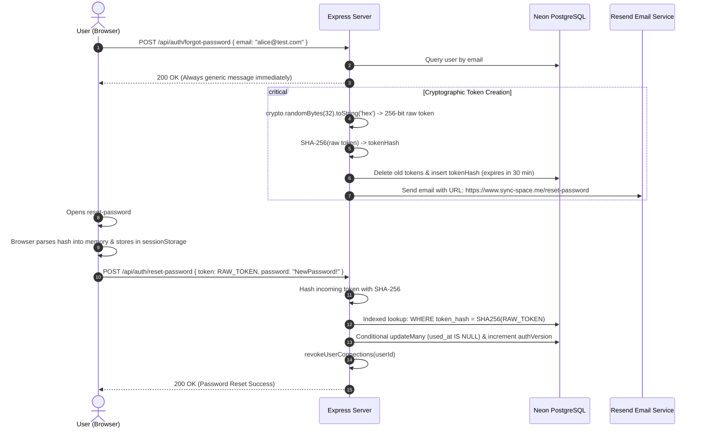

# 06. Authentication, Security & Cryptography

This document covers the security implementation of SyncSpace, detailing JWTs, password hashing, session revocation, OAuth 2.0 PKCE, cryptographic password resets, CORS, and WebSocket defense mechanisms.

---

## 1. Authentication Architecture: Cookies vs. LocalStorage

A central security decision in modern web development is where to store authentication tokens:

| Property | `localStorage` | `httpOnly` Cookie (SyncSpace Choice) |
|---|---|---|
| **Vulnerable to XSS?** | 🚨 **High.** Any injected script or malicious npm package can read `localStorage.getItem('token')` and exfiltrate it. | 🛡️ **Protected.** JavaScript in the browser **cannot** access or read `httpOnly` cookies under any circumstances. |
| **Vulnerable to CSRF?** | 🛡️ Protected (not automatically sent). | 🛡️ **Protected with `SameSite: 'lax'` + Origin validation.** Modern browsers withhold cross-site POST cookies. |
| **Transmission** | Must be manually attached to every `Authorization: Bearer` header. | Automatically attached by the browser on same-site API requests and WebSocket upgrade requests. |

### How SyncSpace Sets the Auth Cookie (`server/lib/auth/jwt.ts`):
```typescript
export function setAuthCookie(res: Response, token: string): void {
  res.cookie(AUTH_COOKIE_NAME, token, {
    httpOnly: true,                               // Inaccessible to client JavaScript (XSS defense)
    secure: process.env.NODE_ENV === 'production',// Enforced over HTTPS in production
    sameSite: 'lax',                              // Prevents CSRF on third-party cross-site requests
    maxAge: COOKIE_MAX_AGE,                       // 7 days in milliseconds
  });
}
```

---

## 2. JWT Configuration & Secret Fail-Fast Hardening

### The Vulnerability SyncSpace Fixed:
In standard tutorials, JWT verification defaults to a hardcoded string:
```typescript
const secret = process.env.JWT_SECRET || 'dev-secret';
```
In production, if an operator forgets to configure `JWT_SECRET`, an attacker who inspects the open-source repository can forge signatures for any `userId` and gain full administrative takeover.

### The Production Hardening in SyncSpace (`server/lib/auth/jwt.ts`):
```typescript
export function getJwtSecret(): string {
  const secret = process.env.JWT_SECRET?.trim();
  const isProduction = process.env.NODE_ENV === 'production';

  if (isProduction) {
    if (!secret) {
      throw new Error(
        '[Security] JWT_SECRET environment variable is missing in production. An explicitly configured, strong secret is required.'
      );
    }
    if (secret === DEV_JWT_FALLBACK_SECRET) {
      throw new Error(
        '[Security] JWT_SECRET must not use the known development fallback in production. Generate a strong secret (e.g. openssl rand -hex 64).'
      );
    }
    if (secret.length < MIN_JWT_SECRET_LENGTH) {
      throw new Error(
        `[Security] JWT_SECRET in production is too short (${secret.length} characters). It must be at least ${MIN_JWT_SECRET_LENGTH} characters long.`
      );
    }
    return secret;
  }

  return secret || DEV_JWT_FALLBACK_SECRET;
}
```
**Key Defenses:**
1. **Fails Fast at Startup:** In `server/index.ts`, `getJwtSecret()` is called before `httpServer.listen()`. The server refuses to boot if misconfigured.
2. **Never Prints Secrets in Logs:** Exception messages only state character length, never echoing token strings.

---

## 3. Instant Session Revocation: The `authVersion` Pattern

### The Problem with Stateless JWTs:
Standard JWTs are stateless. Once signed, they remain valid until expiration (7 days). If a user's laptop is stolen or their password is changed, an attacker possessing the stolen cookie can continue querying the API for the remainder of the 7 days.

### How SyncSpace Implements Instant Invalidation:
1. Every JWT payload carries an `authVersion` integer:
   ```json
   {
     "userId": "c7a8...",
     "email": "user@test.com",
     "authVersion": 3,
     "exp": 1741348800
   }
   ```
2. The `User` table in PostgreSQL has a matching `authVersion` column (default 0).
3. The `requireAuth` middleware and `authorizeYjsConnection` check the database:
   ```typescript
   const authenticatedUser = await prisma.user.findUnique({
     where: { id: payload.userId },
     select: { authVersion: true },
   });
   if (!authenticatedUser || authenticatedUser.authVersion !== payload.authVersion) {
     return res.status(401).json({ error: 'Session invalidated. Please log in again.' });
   }
   ```
4. When a user changes their password or resets their account, SyncSpace increments `authVersion`:
   ```typescript
   await tx.user.update({
     where: { id: user.id },
     data: { authVersion: { increment: 1 } },
   });
   ```
5. **Instant Eviction:** All previously issued tokens on all laptops, phones, and browsers immediately fail validation.
6. **Active WebSocket Severance:** In addition to database checks, `revokeUserConnections(userId)` immediately drops all active WebSocket TCP connections for that user.

---

## 4. Password Hashing with Bcrypt

SyncSpace uses `bcryptjs` with **12 salt rounds** (enforcing a minimum of 10 rounds).

### Why Bcrypt with 12 Rounds?
- **Adaptive Work Factor:** Unlike MD5 or SHA-256 (which are fast algorithms designed for checksums), bcrypt is intentionally CPU-intensive. At 12 rounds ($2^{12} = 4096$ iterations), hashing a password takes ~250–350ms on modern hardware. This is imperceptible for a single user login but renders offline brute-force attacks economically and computationally infeasible.
- **Unique Salt per Password:** Even if two users choose the identical password `"Password123!"`, bcrypt generates a unique 128-bit cryptographically random salt for each, generating completely different hash strings. This prevents Rainbow Table lookups.

---

## 5. OAuth 2.0 / OpenID Connect with PKCE

SyncSpace supports both **Google** (via OpenID Connect discovery) and **GitHub** OAuth.

### Security Mechanisms in SyncSpace OAuth (`server/lib/auth/oauth.ts`, `server/routes/auth.ts`):
1. **PKCE (Proof Key for Code Exchange):**
   Uses `S256` code challenges. A cryptographically random code verifier is generated on the server and hashed with SHA-256 to create the `code_challenge`. The authorization code cannot be exchanged without the original verifier, defeating authorization code injection attacks.
2. **HMAC-SHA256 Signed State Cookie:**
   The OAuth transaction metadata (`provider`, `state`, `verifier`, `returnPath`) is serialized, signed with an HMAC secret, and stored in a short-lived (10 minute) `httpOnly` cookie `oauth_transaction`.
   When the provider redirects back to `/api/auth/:provider/callback`, the signature is verified using `crypto.timingSafeEqual`.
3. **No Automatic Account Linking (Anti-Takeover Policy):**
   ```typescript
   // Excerpt from server/lib/auth/oauth.ts
   // Deliberately never link by matching email. Existing password users must sign in
   // and use a future explicit account-linking flow before adding a provider.
   if (await prisma.user.findUnique({ where: { email: identity.email } })) {
     throw new Error('oauth_account_exists');
   }
   ```
   **The Attack This Prevents:** If an attacker creates an unverified account on an external OAuth provider matching a victim's email, auto-linking would allow the attacker to log into the victim's SyncSpace workspace. SyncSpace rejects this and displays `account_exists`.
4. **Open Redirect Defense:**
   The `returnPath` parameter is sanitized via `safeOAuthReturnPath`: any input containing double slashes (`//`) or resolving to an external origin is forcibly overridden to `/dashboard`.

---

## 6. Cryptographic Password Reset Architecture

The password reset flow in SyncSpace is engineered with zero-trust cryptographic principles:



### Key Security Implementations:
1. **Timing Attack & Email Enumeration Defense:**
   In `server/routes/auth.ts`, `/forgot-password` returns `res.status(200).json({ message: 'If an account exists for this email...' })` immediately. Email generation and database writes occur in a detached async promise. Attackers cannot measure response times to guess if an email is registered.
2. **URL Fragment Privacy (`#token=...`):**
   The reset link uses an anchor/hash fragment:
   `https://www.sync-space.me/reset-password#token=...`
   Per HTTP RFC specifications, **URL fragments are never sent to the web server in HTTP GET requests** and are omitted from HTTP `Referer` headers. If an intermediary proxy or logging server inspects traffic, the reset token is never exposed in server logs.
3. **SessionStorage Refresh Resilience:**
   In [`src/pages/ResetPassword.tsx`](file:///d:/SyncSpace/src/pages/ResetPassword.tsx), the token is cached in `sessionStorage` on initial read. If the user refreshes the page (`F5`), the token is recovered from `sessionStorage` rather than breaking with an "Invalid Link" error. When the password is changed, `sessionStorage` is cleanly wiped.

---

## 7. Origin Security: CORS & WebSocket Hijacking Defense

### 1. Production CORS Policy (`server/lib/config/cors.ts`)
- In production, rejects any origin that is not explicitly in `CLIENT_URL` / `FRONTEND_URL` or matching `sync-space.me`.
- Wildcard `*` is strictly forbidden because `credentials: true` is enabled.

### 2. Cross-Site WebSocket Hijacking (CSWSH) Defense
Because browser WebSocket upgrade requests automatically include ambient credentials (cookies), an attacker hosting `https://evil.com` can create:
```javascript
const socket = new WebSocket('wss://sync-space.me/syncspace:doc:secret-doc-id');
```
The browser sends the victim's `auth_token` cookie along with the handshake.

**SyncSpace Defense in `server/lib/yjs/auth.ts`:**
```typescript
export function verifyWebSocketOrigin(req: IncomingMessage): boolean {
  const originHeader = req.headers.origin;
  const origin = Array.isArray(originHeader) ? originHeader[0] : originHeader;
  return isOriginAllowed(origin);
}
```
During the HTTP `upgrade` event in `server/index.ts`, `verifyWebSocketOrigin(req)` inspects the `Origin` header. If the upgrade originates from an unauthorized website, the connection is instantly rejected with `403 Forbidden` and `socket.destroy()` before the WebSocket handshake ever completes.

