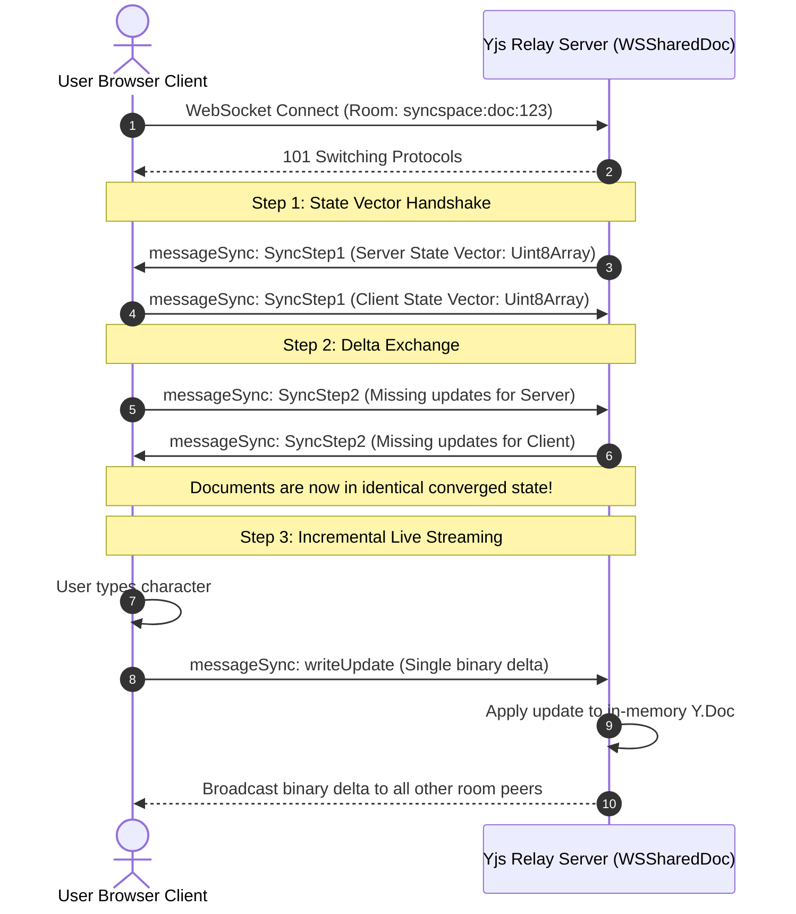

# 07. Real-Time Collaboration & Yjs CRDTs

This document covers the real-time collaborative synchronization engine in SyncSpace, explaining Conflict-Free Replicated Data Types (CRDTs), the Yjs binary protocol, WebSockets, awareness presence, and protocol-level role enforcement.

---

## 1. What is a CRDT? (CRDT vs. Operational Transformation)

A **Conflict-free Replicated Data Type (CRDT)** is a mathematical data structure designed for distributed systems. It allows multiple replicas across different computers to update their local copy independently without central coordination, while guaranteeing that once all replicas receive the same set of updates, they will converge to the **exact same state**.

### CRDT vs. Operational Transformation (OT)

| Dimension | Operational Transformation (OT) <br/>*(Google Docs, Etherpad)* | Conflict-Free Replicated Data Type (CRDT) <br/>*(SyncSpace / Yjs, Figma)* |
|---|---|---|
| **Architecture** | Centralized client-server model. | Decentralized, peer-to-peer capable. |
| **Concurrency Control** | Central server orders every transformation sequentially against historical operations. | Updates commute naturally ($A \cdot B = B \cdot A$); order of arrival does not matter. |
| **Offline Performance** | Poor. Editing offline requires buffering operations that become exponentially difficult to transform against server state. | **Native.** Clients edit offline freely. Merging 10,000 offline edits uses efficient state vector diffs. |
| **Server Complexity** | Very high. Server must maintain full operational history and transformation matrices. | Low. The server acts as a relay merging binary CRDT deltas without transforming them. |
| **Algorithmic Guarantee** | Transformation functions must satisfy TP1 and TP2 mathematical properties (notoriously bug-prone). | Strong Eventual Consistency (SEC) mathematically proven. |

---

## 2. How Yjs Works Internally

**Yjs** is the fastest and most memory-efficient CRDT library in the JavaScript ecosystem.

### Core Concepts in Yjs:
1. **Item & Linked Lists:**
   Yjs stores characters, array elements, and map properties as a doubly-linked list of `Item` structs. Each item has:
   - `id`: A tuple of `(client_id, clock)` (Lamport clock).
   - `left` / `right`: Pointers to adjacent items.
   - `content`: The actual text string or value.
   - `deleted`: Boolean tombstone flag.
2. **State Vectors:**
   A State Vector is a compact map summarizing the highest clock number received from every client:
   $$\text{StateVector} = \{ \text{client}_1: 42, \text{client}_2: 15, \text{client}_3: 88 \}$$
   Instead of sending the entire document over the network, Client A sends its State Vector to Client B. Client B replies with *only* the missing updates that Client A has not yet seen.
3. **Binary Encoding (`lib0`):**
   Yjs does not exchange JSON. It uses a high-performance binary encoding library (`lib0`) utilizing Variable-Length Unsigned Integers (`VarUint`) and binary buffers (`Uint8Array`), compressing network traffic to a fraction of JSON's size.

---

## 3. The 2-Step Synchronization Protocol

When a client connects to a SyncSpace collaboration room, the two peers synchronize using the official `y-protocols/sync` protocol:



---

## 4. SyncSpace Yjs Room Topology

Rooms are partitioned deterministically to guarantee complete isolation across workspaces, documents, and canvases. From [`src/lib/yjs/rooms.ts`](file:///d:/SyncSpace/src/lib/yjs/rooms.ts):

| Room Type | Room Naming Convention | Purpose & Content |
|---|---|---|
| **Directory Room** | `workspace-directory` | Global workspace presence. Tracks which documents users are currently viewing. |
| **Document Room** | `syncspace:doc:<documentId>` | Text document collaboration. Houses `doc.getArray('blocks')`. |
| **Canvas Room** | `syncspace:canvas:<documentId>` | Vector whiteboard collaboration. Houses `doc.getMap('elements')`. |

---

## 5. Protocol-Level Role Enforcement (VIEWER Read-Only)

In many collaborative applications, permissions are checked only when rendering the frontend UI (e.g. hiding the edit toolbar). However, a malicious user could open Chrome DevTools and issue WebSocket frames directly to alter document content.

### How SyncSpace Hardens WebSockets at the Protocol Layer:
In [`server/yjsServer.ts`](file:///d:/SyncSpace/server/yjsServer.ts), every incoming WebSocket binary message is decoded and inspected:

```typescript
// Excerpt from server/yjsServer.ts
conn.on('message', (message: ArrayBuffer) => {
  try {
    const decoder = decoding.createDecoder(new Uint8Array(message));
    const encoder = encoding.createEncoder();
    const messageType = decoding.readVarUint(decoder);

    switch (messageType) {
      case messageSync: {
        const syncMessageType = decoding.readVarUint(decoder);

        if (isViewer) {
          // Viewers are ONLY allowed to send sync step 1 (asking server for doc state)
          if (syncMessageType === syncProtocol.messageYjsSyncStep1) {
            encoding.writeVarUint(encoder, messageSync);
            encoding.writeVarUint(encoder, syncProtocol.messageYjsSyncStep2);
            syncProtocol.writeSyncStep2(encoder, doc);
            send(doc, conn, encoding.toUint8Array(encoder));
          } else {
            // Viewer attempted to send syncStep2 or update -> REJECT modifications!
            const authEncoder = encoding.createEncoder();
            encoding.writeVarUint(authEncoder, messageAuth);
            authProtocol.writePermissionDenied(authEncoder, 'Viewers have read-only permissions.');
            send(doc, conn, encoding.toUint8Array(authEncoder));
          }
        } else {
          // OWNER and EDITOR have full read-write capabilities
          encoding.writeVarUint(encoder, messageSync);
          const fullSyncDecoder = decoding.createDecoder(new Uint8Array(message));
          decoding.readVarUint(fullSyncDecoder); // skip messageSync
          syncProtocol.readSyncMessage(fullSyncDecoder, encoder, doc, conn);

          if (encoding.length(encoder) > 1) {
            send(doc, conn, encoding.toUint8Array(encoder));
          }
        }
        break;
      }
      case messageAwareness: {
        // Cursors and presence are allowed for all collaborators
        awarenessProtocol.applyAwarenessUpdate(doc.awareness, decoding.readVarUint8Array(decoder), conn);
        break;
      }
    }
  } catch (err) {
    console.error('[Yjs Server] Error handling message:', err);
  }
});
```

**Interview Significance:**
- **Zero-Trust:** Even if a user with `VIEWER` permission crafts a custom `SyncStep2` or `Update` packet, the server decodes the frame header, discards the payload, and sends an `authProtocol.writePermissionDenied` message.
- **Read-Only Compatibility:** Viewers can still connect, receive all real-time changes made by editors, and broadcast their presence cursors without being able to corrupt document state.

---

## 6. Awareness & Collaborative Presence

The **Awareness protocol** (`y-protocols/awareness`) handles ephemeral, high-frequency metadata that should **not** be persisted in the document history:
- User display name and avatar color
- Active document ID (`currentDocId`)
- Canvas cursor coordinates `(x, y)`
- Selection ranges and active editing block

### Awareness Throttling (40ms):
In [`src/hooks/useDocumentYjs.ts`](file:///d:/SyncSpace/src/hooks/useDocumentYjs.ts):
```typescript
const handleAwarenessChange = () => {
  const now = Date.now();
  if (now - awarenessThrottleRef.current < 40) return; // Throttled to ~25fps
  awarenessThrottleRef.current = now;
  // Read and update remote user state
};
```
**Why throttling is required:** If 5 users move their mice across the canvas at 120Hz, without throttling, React would attempt 600 state updates per second, completely freezing the browser main thread. Throttling to 40ms preserves fluid 25fps cursor animations while keeping CPU utilization below 2%.

---

## 7. Active Session Eviction (`sessionConnections.ts`)

When a user logs out or has their password reset, standard WebSocket setups leave active sockets open until the user refreshes.

SyncSpace maintains an in-memory session registry in [`server/lib/yjs/sessionConnections.ts`](file:///d:/SyncSpace/server/lib/yjs/sessionConnections.ts):
```typescript
const activeUserSockets = new Map<string, Set<WebSocket>>();

export function registerUserConnection(userId: string, socket: WebSocket): () => void {
  let sockets = activeUserSockets.get(userId);
  if (!sockets) {
    sockets = new Set();
    activeUserSockets.set(userId, sockets);
  }
  sockets.add(socket);
  return () => {
    sockets.delete(socket);
    if (sockets.size === 0) activeUserSockets.delete(userId);
  };
}

export function revokeUserConnections(userId: string): void {
  const sockets = activeUserSockets.get(userId);
  if (sockets) {
    sockets.forEach((ws) => {
      try {
        ws.close(4401, 'Session revoked');
      } catch {
        // Socket already closed
      }
    });
    activeUserSockets.delete(userId);
  }
}
```
Whenever `authVersion` increments or a user calls `/logout`, `revokeUserConnections(userId)` immediately terminates all active WebSocket sockets across all documents.

---

## 8. Offline Resilience via `IndexeddbPersistence`

SyncSpace uses an **offline-first replication strategy**:
1. When a user opens a document, [`useDocumentYjs`](file:///d:/SyncSpace/src/hooks/useDocumentYjs.ts) instantiates:
   ```typescript
   const idbProvider = new IndexeddbPersistence(docName, doc);
   ```
2. The document is immediately read from browser IndexedDB storage and rendered to the screen with **0ms network latency**.
3. If the user loses internet connection, edits are stored in IndexedDB.
4. When the connection re-establishes, `WebsocketProvider` automatically negotiates the state vector handshake and syncs all offline edits to the server.

---

## 9. Current Limitations & Enterprise Scaling

| Aspect | Current Implementation | Enterprise Production Roadmap |
|---|---|---|
| **Server Persistence** | In-memory `WSSharedDoc` instances (`docs = new Map<string, WSSharedDoc>()`). State survives as long as at least one client has an IndexedDB copy. | Mount `y-leveldb` or periodic snapshots stored as binary blobs (`BYTEA`) in PostgreSQL or Amazon S3. |
| **Horizontal Scaling** | Single Node.js process. | Redis Pub/Sub backplane (`y-redis`) to broadcast binary deltas across a multi-node Kubernetes cluster. |
| **Document History** | Snapshots in canvas undo/redo stack. | Implement Yjs snapshots (`Y.snapshot(doc)`) to provide permanent version rollback. |

