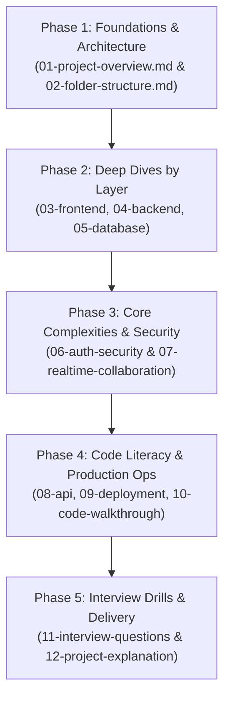

# SyncSpace – Senior Technical Interview Preparation Guide

Welcome to the comprehensive technical interview preparation package for **SyncSpace**. This documentation has been reverse-engineered and authored directly from the production codebase to help you master, defend, and articulate every engineering decision in front of senior technical interviewers.

---

## 📚 Document Index

| # | Document | Primary Focus | Key Concepts Covered |
|---|---|---|---|
| **01** | [`01-project-overview.md`](./01-project-overview.md) | High-Level System Architecture | Problem statement, core features, technology stack, high-level architecture diagram. |
| **02** | [`02-folder-structure.md`](./02-folder-structure.md) | Codebase Topology & Dependencies | Directory anatomy, file-by-file responsibilities, dependency graphs, separation of concerns. |
| **03** | [`03-frontend-deep-dive.md`](./03-frontend-deep-dive.md) | Client Architecture & State | React 18, React Router v7, Context APIs, custom hooks (`useDocumentYjs`, `useCanvasEngine`), UI rendering. |
| **04** | [`04-backend-deep-dive.md`](./04-backend-deep-dive.md) | Server & Middleware Architecture | Node.js v22, Express v5, unified HTTP/WS server, request-response lifecycle, error handling, Zod validation. |
| **05** | [`05-database-and-prisma.md`](./05-database-and-prisma.md) | Data Layer & Persistence | PostgreSQL, Neon serverless, Prisma ORM schema, indexes, transactions, cascade rules, atomic writes. |
| **06** | [`06-authentication-and-security.md`](./06-authentication-and-security.md) | Security & Access Control | JWT in HttpOnly cookies, bcrypt hashing, OAuth 2.0 PKCE, password reset cryptography, session revocation via `authVersion`. |
| **07** | [`07-realtime-collaboration.md`](./07-realtime-collaboration.md) | Real-Time Sync & CRDTs | Yjs internals, CRDT vs OT, WebSockets, state vectors, granular Y.Map mutations, awareness presence, role enforcement. |
| **08** | [`08-api-reference.md`](./08-api-reference.md) | REST API Contract Specification | Exhaustive endpoint catalog, request payloads, response schemas, HTTP status codes, error models. |
| **09** | [`09-deployment-and-environment.md`](./09-deployment-and-environment.md) | Infrastructure & Production Ops | Render deployment, custom domains (`sync-space.me`), SPA redirects (`_redirects`), environment variables, build pipeline. |
| **10** | [`10-code-walkthrough.md`](./10-code-walkthrough.md) | Line-by-Line Code Breakdown | 10 critical code blocks analyzed across 8 dimensions: functionality, internal mechanics, alternatives, and interview traps. |
| **11** | [`11-interview-questions.md`](./11-interview-questions.md) | 100+ Interview Questions & Answers | Beginner, intermediate, and advanced questions with rigorous answers and tricky follow-ups. |
| **12** | [`12-project-explanation.md`](./12-project-explanation.md) | Pitch & Interview Delivery | 30s, 1m, and 3m pitches, technical deep-dive speech, personal contributions, challenge stories, trade-off defenses. |

---

## 🎯 Recommended Study Order

To prepare efficiently for a technical interview, follow this progressive 5-phase study path:

### Phase 1: Foundations & Topology (Days 1–2)
1. Read [`01-project-overview.md`](./01-project-overview.md) to internalize the 30,000-foot view: what problem SyncSpace solves, why CRDTs were chosen over traditional client-server request-reply architectures, and how the stack components fit together.
2. Read [`02-folder-structure.md`](./02-folder-structure.md) to develop a mental map of where every single piece of business logic lives.

### Phase 2: Layered Deep Dives (Days 3–5)
1. Read [`03-frontend-deep-dive.md`](./03-frontend-deep-dive.md) to understand the React 18 component tree, state management patterns (`AuthContext`, `WorkspaceContext`, `DocumentUIContext`), and why custom hooks abstract complex synchronization logic.
2. Read [`04-backend-deep-dive.md`](./04-backend-deep-dive.md) to trace the Express v5 middleware chain, unified HTTP/WebSocket port sharing, and defensive error handling.
3. Read [`05-database-and-prisma.md`](./05-database-and-prisma.md) to master the relational data model, index strategies, foreign key constraints, and transactional consistency.

### Phase 3: The Complex Systems (Days 6–8)
1. Read [`06-authentication-and-security.md`](./06-authentication-and-security.md) to master enterprise-grade authentication: HttpOnly cookie JWTs, session revocation via `authVersion`, PKCE OAuth with CSRF defense, single-use SHA-256 password resets, and timing-attack prevention.
2. Read [`07-realtime-collaboration.md`](./07-realtime-collaboration.md) to understand Yjs Conflict-Free Replicated Data Types, state vectors, WebSocket handshake verification, and protocol-level role enforcement (`OWNER`, `EDITOR`, `VIEWER`).

### Phase 4: Production Reality & Code Literacy (Days 9–10)
1. Review [`08-api-reference.md`](./08-api-reference.md) and [`09-deployment-and-environment.md`](./09-deployment-and-environment.md) to speak fluently about endpoints, status codes, Render hosting, SPA rewrites, and CORS origin validation.
2. Study [`10-code-walkthrough.md`](./10-code-walkthrough.md) line by line. Be prepared to explain any of the 10 core code blocks on a whiteboard or during a live screen-share.

### Phase 5: Rehearsal & Mock Interviews (Days 11–12)
1. Drill the 100+ questions in [`11-interview-questions.md`](./11-interview-questions.md). Test your ability to answer without peeking at the answers first.
2. Practice the verbal explanations in [`12-project-explanation.md`](./12-project-explanation.md). Practice the 30-second elevator pitch, the 1-minute intro, and the 3-minute technical walkthrough out loud until it sounds natural, conversational, and authoritative.

---

## ⚡ Quick Reference Cheat Sheet

- **Core Problem:** Real-time multi-user document and whiteboard collaboration without data loss, write conflicts, or central bottleneck locks.
- **Frontend Stack:** React 18, TypeScript 5.7, Vite 6, Tailwind CSS, Lucide React, Yjs client, `y-websocket`, `y-indexeddb`.
- **Backend Stack:** Node.js v22, Express v5, `ws` (WebSocket server), Prisma ORM v6, `bcryptjs`, `jsonwebtoken`, `openid-client` v6.
- **Database:** Serverless PostgreSQL on Neon, connected via connection pooling with SSL.
- **Conflict Resolution:** Yjs CRDTs (Conflict-free Replicated Data Types) utilizing State Vectors and incremental update logs.
- **Collaborative Transport:** Unified HTTP & WebSocket server operating on a single TCP port (`process.env.PORT || 5000`).
- **Security Paradigm:** 
  - JWT stored in `httpOnly`, `sameSite: 'lax'`, `secure: true` cookie.
  - Active session invalidation via incrementing `authVersion` on the User model.
  - Password hashing with bcrypt (12 salt rounds, minimum 10).
  - Password reset tokens: 256-bit entropy, single-use, deterministic SHA-256 indexed hash in DB, delivered in URL hash (`#token=...`) to prevent referrer/log leakage.
  - Granular role enforcement at WebSocket upgrade AND protocol frame levels (`OWNER`, `EDITOR`, `VIEWER`).
- **Deployment:** Render web service with apex-to-www canonical redirects (`sync-space.me` -> `www.sync-space.me`) and SPA fallback routing (`_redirects` / Express fallback).

